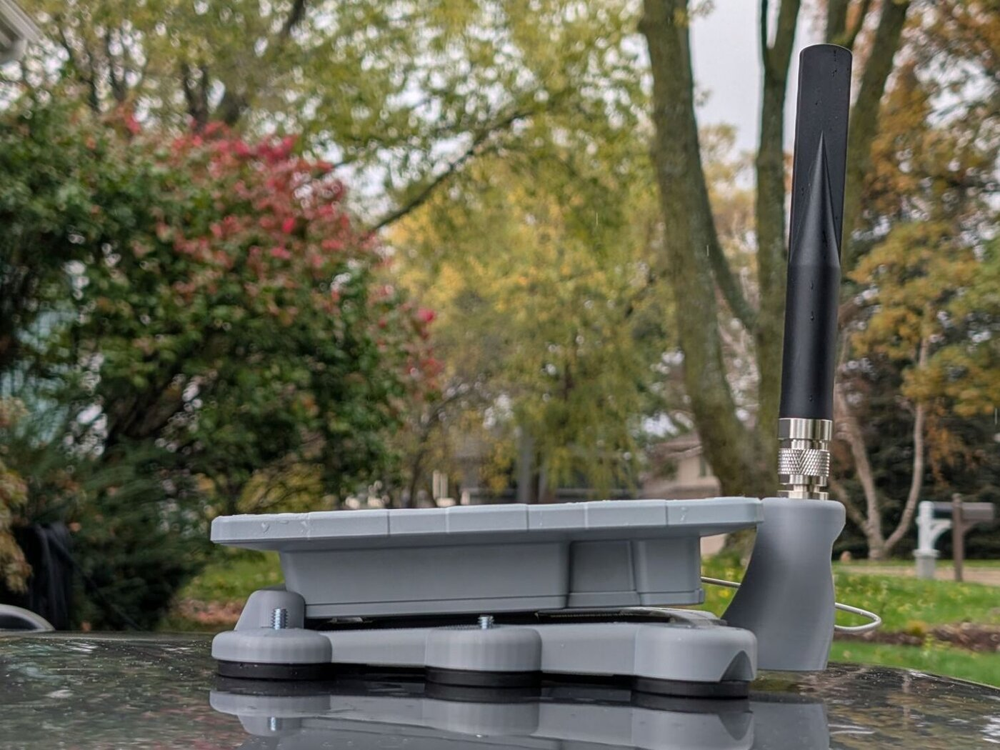
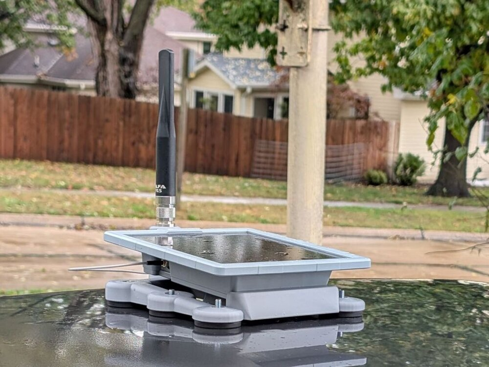
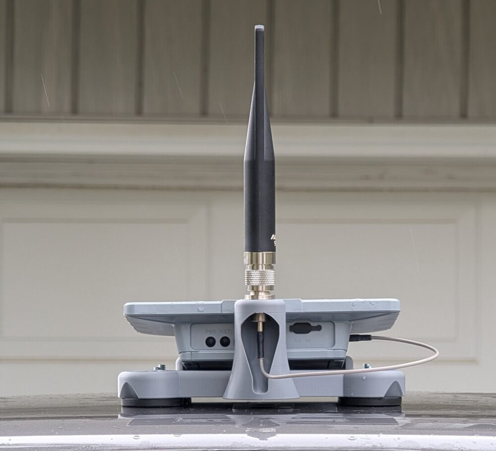
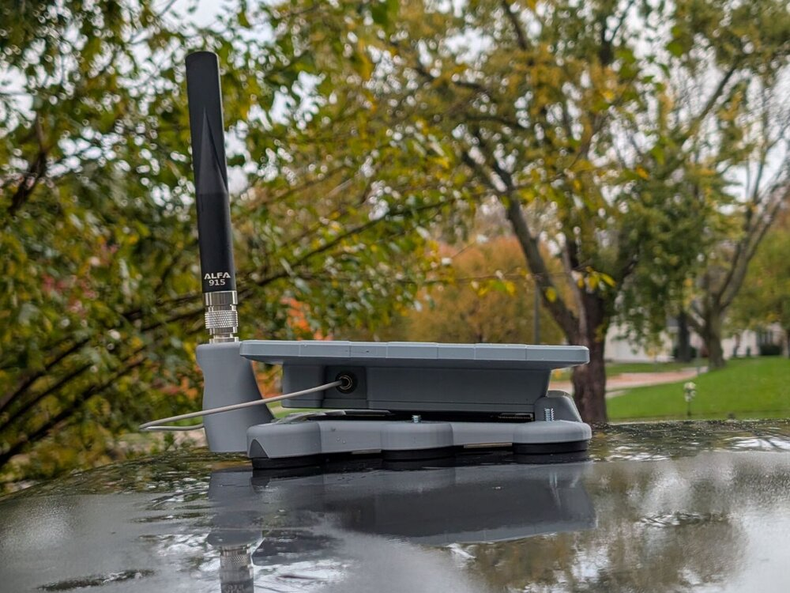
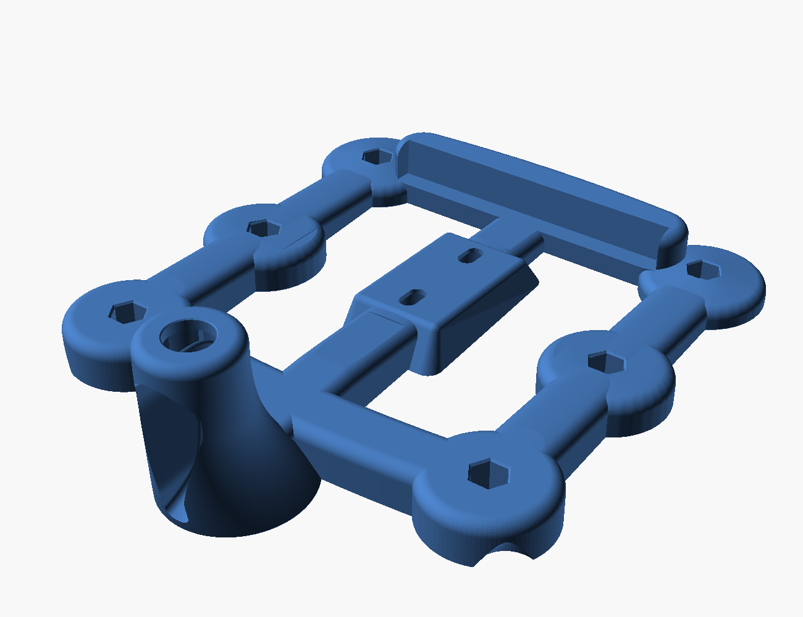
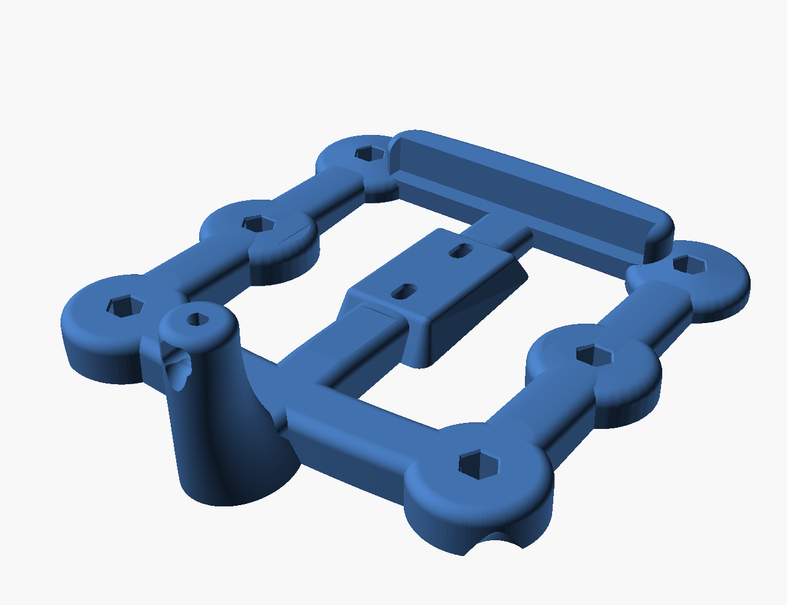

# SenseCAP Solar Node P1 magnetic roof mount



A one-piece magnetic car-roof mount for the Seeed SenseCAP Solar Node P1 / P1-Pro. The node bolts to a center hub through its two 1/4-20 back inserts, tilted 4° nose down. Six stud magnets hold the frame to the roof. A swept pylon behind the node carries the antenna on its bulkhead connector: an N-type bulkhead for an external antenna, or the node's stock RP-SMA rod. Version 1.0.

> **Warning: this holds a roof-mounted load with magnets, and nobody has road-tested it.** Use it on a steel roof only; aluminum and composite roofs will not hold, so test a bare magnet first. The 30 lb magnet rating is straight-pull on thick flat steel, and sliding grip through paint and rubber is much lower. A curved roof may keep some feet from seating. Keep the roof and feet clean, since grit scratches paint. No car washes, and no highway speeds until you have tested it at low speed on your own car. A tether to a roof rail or door is a sensible backstop. Check the magnets before every drive. Keep magnets away from pacemakers, and mind your fingers. You build and use it at your own risk, and roof loads may be regulated where you live.

Not affiliated with or endorsed by Seeed, ALFA, DIYMAG or any other vendor named here.

The N-type frame as built, from the top, the rear and the left side:

  

Renders of the N-type and stock frames:





## Files

| File | Print? | Purpose | `antenna` | `part` |
|---|---|---|---|---|
| `p1-roof-mount-n-type.stl` | yes | Frame for an N-type bulkhead antenna | `alfa` | `mount` |
| `p1-roof-mount-stock.stl` | or this (untested) | Frame for the stock RP-SMA antenna; never printed | `stock` | `mount` |
| `p1-coupon-pylon.stl` | test | N-type pylon: washer, nut, bore fit and support cleanup | `alfa` | `coupon` |
| `p1-coupon-seat.stl` | test | Node screw pockets and tool access | either | `seat_coupon` |
| `p1-coupon-front-foot.stl` | test | Front magnet foot | either | `foot_coupon` |
| `p1-coupon-rear-right-foot.stl` | test | Right rear foot and grip | either | `rear_foot_coupon` |
| `p1-coupon-rear-left-foot.stl` | test | Left rear foot and grip | either | `rear_left_foot_coupon` |
| `p1-roof-mount.scad` | source | OpenSCAD model | | |
| `p1-node-model.scad` | source | Fit-check model of the P1, used by the main source | | |

`antenna = "alfa"` is the N-type variant, named for the ALFA antenna it was sized around. Coupons are optional test pieces, not assembly parts. Print the pylon and seat coupons first.

## Print settings

- Printer: Bambu P1S (256 mm bed). Frames are 200 × 241.5 × 68 mm (N-type) and 200 × 231.6 × 68 mm (stock).
- Material: ASA, light color.
- 0.2 mm layers, 6 walls, 40% infill, 4 mm brim.
- Orientation: feet down, as exported. Center on the bed.
- Supports: under the pylon crown and hardware chamber, and the two node-screw ceilings. The flat feet need none.

The N-type frame has been printed in ASA, fits and assembles as described. The stock frame has not been printed, so treat it as untested. Treat these as starting settings and tune with the coupons.

## Bill of materials

| Qty | Part | Notes |
|---|---|---|
| 1 | Seeed SenseCAP Solar Node P1 or P1-Pro | |
| 6 | DIYMAG rubber-coated mounting magnet, 1.69" (43 mm) base, 1/4-20 male stud, 30 lb ([Amazon B0FX1XP121](https://www.amazon.com/dp/B0FX1XP121), 12-pack) | Amazon variant "1/4in-30LB-1.69in". The foot is sized for a 12.7 mm stud; avoid the M5 and female-thread versions. |
| 6 | 1/4-20 nylon-insert lock nut, 7/16" across flats | Pressed into the feet, nylon up |
| 2 | 1/4-20 × 1/4" socket head cap screw | Into the node's back inserts |
| 3-4 | 1/4" flat washer | Under the screw heads so the screws tighten before they bottom in the inserts: the built frame needed about two at the front and one at the rear |
| 1 | Seeed 100007236 RP-SMA male to N-female bulkhead cable, 300 mm, RG316 ([Seeed](https://www.seeedstudio.com/RF-Cable-RP-SMA-Male-to-N-Type-SMA-Female-300mm.html)) | N-type frame only |
| 1 | ALFA AOA-915-5ACM 5 dBi N-male antenna ([Rokland](https://store.rokland.com/products/alfa-aoa-915-5acm-5-dbi-omni-outdoor-915mhz-802-11ah-mini-antenna-for-lora-halow-application)) | N-type frame only |
| 1 | The node's 300 mm RP-SMA bulkhead pigtail and stock rod antenna | Stock frame only; ships with the node |
| | Blue (medium-strength) threadlocker | Node screws |
| ~400 cm³ | ASA filament | Solid-model volume of one frame; slicer usage is lower at 40% infill |

N-type hardware dimensions are modeled from datasheets and are still provisional; the stock pigtail is measured from a scaled photo. Confirm the nut corners, washers, thread length, socket and magnet studs with the coupons.

## Assembly

1. Press the lock nuts into the feet, nylon up, and thread on the magnets.
2. Fit the bulkhead connector. N-type: the connector drops in from above and its nut and washer go on from the rear chamber. Stock: the jack pushes up from inside the rear recess with both washers on its body and the nut goes on top. Full steps are in `docs/print-notes.md`.
3. Bolt the node to the hub with threadlocker, with washers under the screw heads. Add washers until each screw clamps the node before it bottoms in its insert.
4. Remove the mount by lifting one rear corner at the grip under the boss, never by the node.

## Rebuild

Needs a recent OpenSCAD nightly with the Manifold backend on PATH (the manifest records 2026.10.11) and Python 3.

```sh
python3 tools/check_parameters.py
python3 tools/build_models.py
```

The build writes the seven STLs and `BUILD-MANIFEST.json` only after its geometry checks pass. OpenSCAD tessellation varies between runs, so a rebuild passes the same checks but does not reproduce the released mesh hashes. The section audits in `audits/` regenerate with the `audit_layers.py` commands in `docs/validation.md`. Renders come from the `.scad` scripts in `images/`, each of which stores its camera:

```sh
openscad --render --colorscheme Tomorrow --imgsize 1300,1000 -o images/overall.png images/overall.scad
```

## Layout

| Path | Contents |
|---|---|
| `docs/` | Print notes and validation results |
| `images/` | Renders and the `.scad` scripts that produce them |
| `audits/` | Horizontal-section audit data for both frames |
| `tools/` | Build and validation scripts |

## Limits

No aerodynamic, road-load, torque or temperature testing has been done. See the warning at the top.

## License

Copyright 2026 James Rich. The models, STLs, renders and docs are licensed under [CC BY-SA 4.0](https://creativecommons.org/licenses/by-sa/4.0/); see `LICENSE`. The scripts in `tools/` are licensed under the [GNU GPL v3](https://www.gnu.org/licenses/gpl-3.0.html); see `tools/LICENSE`.
