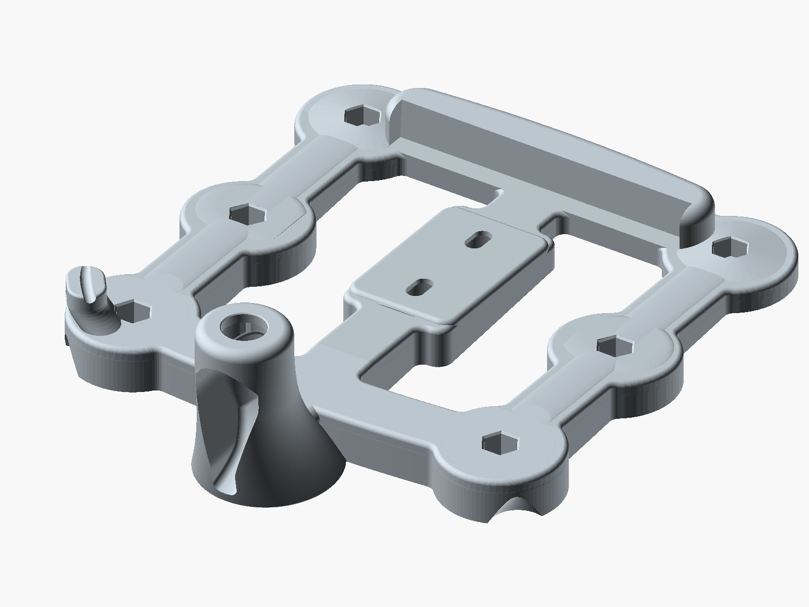
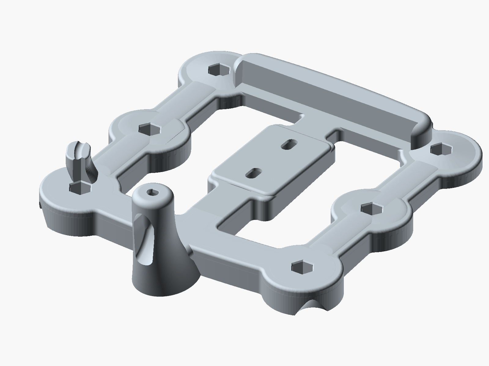

# SenseCAP Solar Node P1 magnetic roof mount



A one-piece magnetic car-roof mount for the Seeed SenseCAP Solar Node P1 / P1-Pro. The node bolts to a center hub through its two 1/4-20 back inserts, tilted 4° nose down. Six stud magnets hold the frame to the roof. A swept pylon behind the node carries the antenna on its bulkhead connector: an N-type bulkhead for an external antenna, or the node's stock RP-SMA rod. Proposed version 1.1; the refinements have not been physically printed or qualified.



## Proposed v1.1 refinements

This revision adds rounded R4 frame-window roots with separate R2 upper-edge relief, an integrated left-rear cable-tie saddle for each antenna variant, a stock-bore entry lead-in and stock-pylon coupon, and optional screw-stack calibration shims. The node seat, original 2 mm bearing web, slot travel and six magnet mounting datums are retained. Reference-only complete cable routes support nominal assembly checks.

[Before-and-after renders](comparison/before-after-overview.png) · [Detailed changes and remaining checks](docs/REVISION-1.1.md) · [Full visual report](COMPARISON.html) · [Build evidence](BUILD-MANIFEST.json)

The source remains editable in `p1-roof-mount.scad` and `assembly-refinements.scad`. The hardware list and assembly workflow below are retained from v1.0. No shim thickness is selected without measured insert depths and washers. Roof conformity, an independent tether, cable slack, heat/UV/creep behavior and road retention remain unverified.

For **fit/support evaluation on a Bambu A1, 0.4 mm nozzle**, open the [stock project](slicer/stock/p1-v11-stock-A1-supported.3mf) or [N-type project](slicer/n-type/p1-v11-n-type-A1-supported.3mf) as a project, keeping its settings. Both are sliced with provisional Bambu PETG HF, 0.2 mm model layers, six walls, 40% infill, 1.2 mm skins and normal automatic supports. These prototype files do not qualify PETG for vehicle-roof service or replace the original ASA/P1S material decision. The actual filament and AMS mapping must be confirmed before printing.

A stock-specific [fill-preserving slicer workaround](docs/STOCK-SLICER-FIX.md) and [GUI preset import correction](docs/GUI-PROJECT-FIX.md) are included. The corrected files retain their settings through actual GUI save/reopen checks. Print the relevant fit coupons before a complete mount.

## Files

| File | Print? | Purpose | `antenna` | `part` |
|---|---|---|---|---|
| `p1-roof-mount-n-type.stl` | yes | Frame for an N-type bulkhead antenna | `alfa` | `mount` |
| `p1-roof-mount-stock.stl` | or this | Frame for the stock RP-SMA antenna | `stock` | `mount` |
| `p1-coupon-pylon.stl` | test | N-type pylon: washer, nut, bore fit and support cleanup | `alfa` | `coupon` |
| `p1-coupon-seat.stl` | test | Node screw pockets and tool access | either | `seat_coupon` |
| `p1-coupon-front-foot.stl` | test | Front magnet foot | either | `foot_coupon` |
| `p1-coupon-rear-right-foot.stl` | test | Right rear foot and grip | either | `rear_foot_coupon` |
| `p1-coupon-rear-left-foot.stl` | test | Left rear foot and grip | either | `rear_left_foot_coupon` |
| `p1-roof-mount.scad` | source | OpenSCAD model | | |
| `p1-node-model.scad` | source | Fit-check model of the P1, used by the main source | | |
| `assembly-refinements.scad` | source | Editable cable routes, saddle, screw shims and assembly references | | |
| `p1-coupon-pylon-stock.stl` | test | Stock connector fit and support cleanup | `stock` | `coupon` |
| `p1-screw-shim-set.stl` | optional test | Four separate calibration shims; no thickness selected | either | `shim_set` |
| `p1-screw-shim-calibration-kit.3mf` | optional test | Geometry-only kit; four named parts, no printer profile | | |

`antenna = "alfa"` is the N-type variant, named for the ALFA antenna it was sized around. Coupons are optional test pieces, not assembly parts. Print the pylon and seat coupons first.

## Print settings

- Printer: Bambu P1S (256 mm bed). Frames are 200 × 241.5 × 68 mm (N-type) and 200 × 231.6 × 68 mm (stock).
- Material: ASA, light color.
- 0.2 mm layers, 6 walls, 40% infill, 4 mm brim.
- Orientation: feet down, as exported. Center on the bed.
- Supports: under the pylon crown and hardware chamber, and the two node-screw ceilings. The original flat foot undersides need none; inspect supports around the added cable saddle and tie-eye roof.

The original v1.0 N-type pylon was printed and assembled successfully. This v1.1 revision has not been printed, and the stock pylon remains unprinted. Treat these as starting settings and tune with the coupons.

## Bill of materials

| Qty | Part | Notes |
|---|---|---|
| 1 | Seeed SenseCAP Solar Node P1 or P1-Pro | |
| 6 | DIYMAG rubber-coated mounting magnet, 1.69" (43 mm) base, 1/4-20 male stud, 30 lb ([Amazon B0FX1XP121](https://www.amazon.com/dp/B0FX1XP121), 12-pack) | Amazon variant "1/4in-30LB-1.69in". The foot is sized for a 12.7 mm stud; avoid the M5 and female-thread versions. |
| 6 | 1/4-20 nylon-insert lock nut, 7/16" across flats | Pressed into the feet, nylon up |
| 2 | 1/4-20 × 1/4" socket head cap screw | Into the node's back inserts |
| 3-4 | 1/4" flat washer | Under the screw heads so the screws tighten before they bottom in the inserts: the built frame needed about two at the front and one at the rear |
| 1 | Seeed 100007236 RP-SMA male to N-female bulkhead cable, 300 mm, RG316 ([Seeed](https://www.seeedstudio.com/RF-Cable-RP-SMA-Male-to-N-Type-SMA-Female-300mm.html)) | N-type frame only |
| 1 | ALFA AOA-915-5ACM 5 dBi N-male antenna ([Rokland](https://store.rokland.com/products/alfa-aoa-915-5acm-5-dbi-omni-outdoor-915mhz-802-11ah-mini-antenna-for-lora-halow-application)) | N-type frame only |
| 1 | The node's 300 mm RP-SMA bulkhead pigtail and stock rod antenna | Stock frame only; ships with the node |
| | Blue (medium-strength) threadlocker | Node screws |
| ~400 cm³ | ASA filament | Solid-model volume of one frame; slicer usage is lower at 40% infill |

N-type hardware dimensions are modeled from datasheets and are still provisional; the stock pigtail is measured from a scaled photo. Confirm the nut corners, washers, thread length, socket and magnet studs with the coupons.

## Assembly

1. Press the lock nuts into the feet, nylon up, and thread on the magnets.
2. Fit the bulkhead connector. N-type: the connector drops in from above and its nut and washer go on from the rear chamber. Stock: the jack pushes up from inside the rear recess with both washers on its body and the nut goes on top. Full steps are in `docs/print-notes.md`.
3. Bolt the node to the hub with threadlocker, with washers under the screw heads. Add washers until each screw clamps the node before it bottoms in its insert.
4. Remove the mount by lifting one rear corner at the grip under the boss, never by the node.

## Rebuild

Needs Python 3 and a current OpenSCAD with Manifold support; the recorded build used OpenSCAD 2026.10.27. Install `tools/requirements-v11.txt` in a virtual environment. Pass the OpenSCAD executable explicitly or place it on PATH:

```sh
python3 tools/check_parameters.py
python3 tools/build_models.py --openscad /path/to/openscad
python3 tools/export_shims.py --openscad /path/to/openscad
python3 slicer/verify_projects.py
```

The build writes eight frame/coupon STLs and `BUILD-MANIFEST.json` only after geometry checks pass. Shims are exported separately. Native blends are evaluated once per variant within a build; the source always constructs its geometry directly when the optional cache is unset. Tessellation can vary on rebuilding, so use geometric checks rather than expecting identical mesh hashes. See [review reproduction](docs/REVIEW-REPRODUCTION.md) for render and assembly checks and the scope of retained historical evidence.

The original v1.0 image scripts remain in `images/`; the v1.1 matched comparisons use `comparison/render_comparison.py`. To regenerate an original image script against the current source:

```sh
openscad --render --colorscheme Tomorrow --imgsize 1300,1000 -o images/overall.png images/overall.scad
```

## Layout

| Path | Contents |
|---|---|
| `docs/` | Print notes and validation results |
| `images/` | Renders and the `.scad` scripts that produce them |
| `audits/` | Horizontal-section audit data for both frames |
| `tools/` | Build and validation scripts |

## Limits

No aerodynamic, road-load, torque or temperature testing has been done. Check the magnets before every drive.

## License

Copyright 2026 James Rich. Licensed under [CC BY-SA 4.0](https://creativecommons.org/licenses/by-sa/4.0/); see `LICENSE`.
